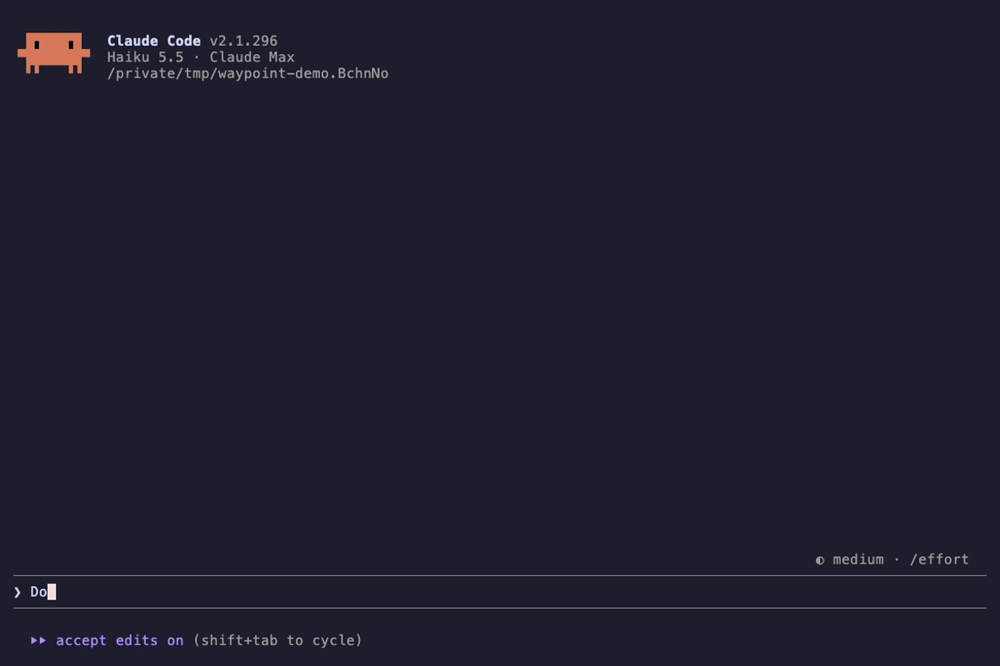
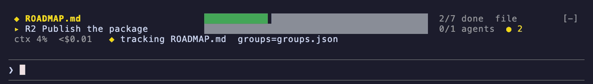
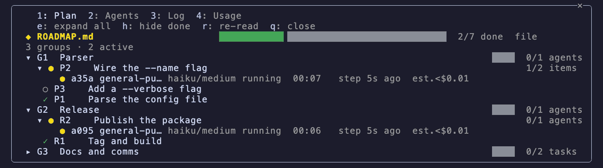
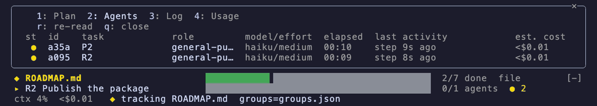
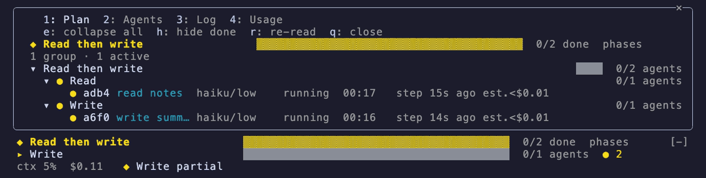
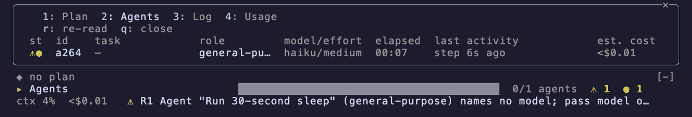

# headway

**Goal, tasks and agents above your Claude Code prompt — zero setup.**

[](https://github.com/atharv6f/headway/tags)
[](LICENSE)
[](#compatibility-and-known-limits)



Type a prompt that asks for more than one thing. Claude reports the steps; headway draws the goal,
the step it is on, every subagent under the step it works on, who is blocked or stalled, and what the
session costs. No plan file needed; pin one if you keep one.

## Install

Inside Claude Code:

```
/plugin marketplace add atharv6f/headway
/plugin install headway@headway
```

then restart Claude Code. Needs Claude Code 2.1.287 or later. No dependencies.

Update with `claude plugin marketplace update headway` and `claude plugin update headway@headway`,
then restart.

## What you get

- **A band above the prompt, always on.** Line 1 the goal and its progress, line 2 the current step
  and its agents, line 3 context fill, the exact session cost and the newest event.

  

- **A Plan tab** (`/headway`): the tree of groups, steps and the agents under each. The plan comes
  from the first of these that has data: a plan file you pin, the list Claude reports, a plan you
  approve in plan mode, Claude's task tools, or a Workflow's phases.

  

- **An Agents tab:** every subagent with its status, model and effort, elapsed time and estimated
  cost; blocked and stalled ones called out, each with the short id `SendMessage` takes.

  

- **Workflow phases as the plan.** A Workflow script that declares `meta.phases` is tracked as one
  group, one task per phase, each `agent()` call under its phase.

  

- **Router warnings.** A dispatch that names no model, a Workflow `agent()` without model or effort,
  or a role sent to a model your role file does not allow gets an amber `⚠`, a toast and one line in
  Claude's context so the next dispatch is right. Warnings never block a call.

  

- **Quiet transcript rows and a small footprint.** headway's own tool calls draw as one dim line
  each, not a JSON block. It never writes a file of yours, never denies or rewrites a tool call,
  makes no network request and runs no subprocess. [Trust](#trust) lists everything it reads.

## Why headway

The nearest mods, as their READMEs and the awesome-claude-code-mods scanner data described them on
2026-10-10. "yes" and "no" are what a README says; "—" means its README does not describe the point.
Found a row that is wrong? Open an issue.

| | headway | [Flightdeck](https://github.com/scasella/claude-flightdeck) | [plan-progress](https://github.com/zycck/claude-mods) | [savvy-progress](https://github.com/JohnnyVizz/claude-kit) | [GlanceFlow](https://github.com/Antreas-Strb/glanceflow) |
| :- | :- | :- | :- | :- | :- |
| Works from a plain prompt, no plan file | yes | no plan concept; observes events | yes | through the author's savvy-flow skill | yes |
| Pins a plan file you keep (checklist or table), read and never written | yes | — | no | — | no |
| Plan-mode plan as the source | yes | no | yes | — | — |
| Claude's task tools as the source | yes (opt-in in Claude Code) | — | — | — | — |
| Workflow phases as the plan | yes | workflow agents shown, not as a plan | — | — | — |
| Agents grouped under their step | yes, by step id | cards and swimlanes, no steps | yes | agent panel | yes |
| Model and effort warnings on a dispatch | yes, plus an optional role file | no | — | — | — |
| Session cost | exact, from the engine ledger | yes | no | its own estimate | per job, where Claude Code keeps a cost |
| Per-agent cost | estimate, labelled `est.` | no | no | estimate | per job |
| Network calls | none | none | none in the scanner call list | none in the scanner call list | none in the call list; one Haiku model call per job |
| Subprocesses | none | none | `$.process.run` | none in the scanner call list | `$.process.run` |

What headway adds to Claude's context, in full, is quoted in [Trust](#trust): one 153-word guidance
section per session and a 50-word note at a plan-mode approval.

## Quickstart (60 seconds)

No setup. In any directory, type a prompt that asks for more than one thing:

```
Create hello.py that prints a greeting, add a --name flag to it, then write a test for it.
```

Claude calls the `headway` tool once with the three steps, then marks each one as it starts and
finishes. The band appears above your prompt:

```
 ◆ Add a --name flag to hello.py  ██████████▓▓▓▓▓▓▓▓▓▓░░░░░░░░░░  done 1 · partial 1 · open 1 / 3  reported
 ▸ 2 Add a --name flag            ◐ in progress
 ctx 6%  $0.04   ✓ 1 done
```

and ends at `3/3 done`. The goal label is the short title Claude passes with the list (six words at
most), else the first line of your prompt. The dim word after the count (`reported`) names where the
plan came from. `/headway` opens the pane, `1`–`4` switch tabs, `q` closes it. A prompt that asks for
one thing draws nothing.

## Plan sources

The goal is drawn from the first source in this order that has data. A lower source keeps its data
while a higher one is shown; when the higher one goes (an `untrack`, a cleared report) the next
shows.

| # | Source | Tag | Has data when |
| :- | :- | :- | :- |
| 1 | a plan file you pin | `file` | `/headway track` (or the tool's `track`) has pinned a filter |
| 2 | a list Claude reports | `reported` | Claude called `report` with at least one task |
| 3 | a plan-mode plan you approve | `plan` | an approved plan parsed to at least one step |
| 4 | Claude's task tools | `tasks` | `TaskCreate`/`TaskUpdate`/`TodoWrite` built a list (off by default, see below) |
| 5 | a Workflow's phases | `phases` | a Workflow run whose script declares `meta.phases` has started |
| 6 | nothing | | agents exist: they are grouped by where they came from |

### 1. A pinned plan file

Your plan file stays the only record; headway reads it and never writes it. Two shapes, which may
share a file: a Markdown checklist and a GFM table.

A checklist, say `ROADMAP.md`:

```markdown
## Milestone A
- [x] A1 Parse the config file
- [ ] A2 Wire the `--name` flag
  - [x] argparse
  - [ ] tests
- [ ] Write the release note
```

```
/headway track ROADMAP.md "Milestone A"
```

`A1` is done, `A2` is open with a 1/2 bar from its sub-items (sub-items are the parent's bar, not
tasks), and the third item has the ID `#3`. The section argument matches a heading as a
case-insensitive prefix (`Milestone A` matches `## Milestone A (4 items)`) and runs to the next
heading of the same or a higher level; no section means the whole file.

A table, say a release checklist in the same file:

```markdown
## Release
| id | title                     | shipped    | announced |
| :- | :------------------------ | :--------- | :-------- |
| R1 | Tag and build             | 2026-10-02 | yes       |
| R2 | Publish the package       | 2026-10-03 |           |
| R3 | Update the install docs   |            |           |
```

```
/headway track ROADMAP.md "Release" column=shipped partial=announced
```

counts `shipped 2 · announced 1 · open 1 / 3`: the column headers, as written, are the words the
counts use. Done rules: `column=<name>` (done when the cell is non-empty; blank, `-`, `–`, `—` and
`[ ]` are empty), `check=<name>` (done when the cell holds `[x]`), or `auto` (the default: a
`[ ]`/`[x]` column if the first row has one, else a column named `done`, else every row open with
`no done rule` after the count). `partial=<column>` is independent of the done rule and uses the
same emptiness test. A rule naming a column the table lacks is refused (`column not found: shipped`).

**Groups.** A task's group is the nearest heading above it with an ID of its own (else the nearest
heading). A group map replaces that for the tasks it names:

```
/headway track ROADMAP.md groups=groups.json
```

```json
{ "groups": [
  { "id": "G1", "title": "Parser",  "rows": ["A1", "A2"] },
  { "id": "G2", "title": "Release", "rows": ["R1", "R2", "R3"] }
] }
```

A row ID matching no task is counted in the Plan tab footer as `n unmapped rows`.

**IDs.** The leading token of a row's first cell or an item's text (`A1`, `R2`, `Step 2`, `T08-25`)
is the task ID when it holds a digit; otherwise the task is `#<n>`, its ordinal in the section.
Agents are matched to tasks by these IDs (below), as literal text.

The file is stat-polled every 2 s and re-parsed when it changes; a task that flips is logged. A read
or parse error keeps the last good parse and shows `plan unreadable` on line 1 until the next good
read. Pinning the same filter again re-reads; another filter replaces it (agents still at work stay
and are re-matched, finished ones are dropped). `/headway untrack` unpins; the next source shows.

### 2. A list Claude reports

With no file pinned, headway adds one short section to Claude's system prompt (the text is in
[Trust](#trust)): for a request that asks for two or more things, call the `headway` tool once with
`action: "report"` and one short title per thing asked, then mark each step `partial` before starting
it and `done` after. That is what the quickstart shows. Claude also gives the list a short `title`
(six words at most), which is the goal label; the steps get ids `1..n` unless it names its own. The
list stands until a plan-mode approval or Claude's next full list; a pinned file hides it without
ending it. A list holds at most 200 steps and a title at most 200 characters; a longer list is
refused, a longer title is cut. Text that Claude or a plan file wrote is shown as one plain line:
line breaks, control characters and terminal escape sequences (colour codes, links, title changes)
are removed.

### 3. A plan-mode plan

Enter plan mode (shift+tab), let Claude write a plan, approve it. The approved plan becomes the
source: the `# Plan: ...` title is the goal label, and the steps are the first of these the plan body
has: its checklist items; its numbered items (numbering may continue across `## Phase N` headings,
which become groups; indented sub-steps are the step's bar); its headings of bullets (one step per
heading); or its headings that carry an ID (`### Step 2`, `## 3. Wire it`), prose under them or not.
Sections about the work rather than steps of it are left out first: a heading reading Context,
Background, Summary, Overview, Goal(s), Files, Critical files, Key files, Risk(s), Out of scope,
Non-goals, Notes, Open questions, Questions, Alternatives, Assumptions, Dependencies, Verification,
Testing, Test plan, Acceptance (criteria), Done when, Rollback or References, in any case, and
everything under it. Only a plan with no step outside those sections takes its steps from them.
Prose is ignored.

Every step is open at approval; Claude's `report` `updates` by step id and the agents it dispatches
move them. A rejected plan changes nothing. An approval starts a new piece of work: it clears the
reported list and the task-tool list.

The guidance tells Claude that an approved plan is already tracked and to send `updates` with the
step ids `state` shows (`1`, `2`, … or `1.1`, `2.1`, … where numbering restarts under each phase),
and the approval itself carries a short note that names the steps and the two calls to make (see
[Trust](#trust)). Two things are also turned away, so a Claude that forgets cannot hide the plan:
while the plan is unfinished, the tool's `track` of the plan's own file pins nothing, reads nothing
and replies with the ids (any other file is held to the project as usual, so another plan file, and
this one once the plan is finished, is refused unread); and a full `report` list in the turn of the
approval is refused with the ids. That turn ends when Claude's turn completes, at the next prompt of
any kind, or at Claude's first `updates` call; after it a full list replaces the plan as usual.

### 4. Claude's task tools

Claude Code's `TaskCreate`/`TaskUpdate` (and the older `TodoWrite`) are **off by default** on
current models. To turn them on, put `CLAUDE_CODE_ENABLE_TODO_TOOLS=true` in the `env` block of
your settings (`CLAUDE_CODE_ENABLE_TASKS=false` as well selects `TodoWrite`). With them on, the
list Claude keeps is the source: pending is open, in_progress is partial, completed is done,
deleted removes the item. The list survives `claude --resume` (rebuilt from Claude Code's task files
for the session, or from headway's own saved copy once those are gone). A subagent's task calls are
ignored; subagents have no task tools.

### 5. A Workflow's phases

A Workflow script that declares `meta.phases` (`export const meta = { name, description, phases:
['Read', 'Write'] }`) is a plan: the run is one group titled by `meta.description`, each phase is a
task, and each `agent()` call sits under the phase named by its `phase:` option (or the last
top-level `phase('name')` statement before it). A phase is partial while one of its agents runs,
done when every agent of it has finished. A phase whose latest attempt failed shows `✕` and does
not count as done. The source stays after the run ends until a higher source appears or a newer run
with phases replaces it.

### 6. Nothing: grouping by origin

With no source, agents are grouped by where they came from: a Workflow agent under its run (titled
by `meta.description`, else `meta.name`, else `Workflow <id>`), a plain Agent-tool agent under
`Agents`. Line 1 reads `◆ no plan` while agents are at work. These groups also take an agent that
matches no task when a source is active; they never count toward the goal.

### Matching an agent to a step

An agent lands under the step whose ID appears as a whole word in its name, description, the first
2000 characters of its prompt, or (for a Workflow agent) its label or phase; longer IDs win (`A12`
before `A1`). A bare numeric step (`3`, from a reported or plan-mode list) matches only as `step 3`,
`#3`, or `3:`/`3.` at the start of the text, never a loose `3`; a heading-text ID (no digit) matches
in any case in the agent's name, description or label, and in its own case in the prompt; an ID with
a digit is case-sensitive everywhere. With no ID match and exactly one step `partial` in a reported,
plan-mode or task-tool list, the agent attaches to that step. Otherwise it goes to its origin group.

## Commands and keys

| Command | Does |
| :- | :- |
| `/headway` | opens the pane (or the expanded band when the pane cannot be placed); again closes it |
| `/headway track <path> ["Section text"] [column=<name> \| check=<name> \| auto] [partial=<column>] [groups=<path>]` | pins a plan file; prints `tracking <file> § <section>: <counts> tasks, <n> groups` or `refused: <reason>` |
| `/headway untrack` | unpins the file; the next source with data shows |
| `/headway plan` · `agents` · `log` · `usage` | opens the pane on that tab |
| `/headway close` | closes the pane or the expanded band |
| `/headway status` | prints the `state` block: goal, current step, blocked and stalled agents, every agent with its short id (for SendMessage), the log, context and cost |
| `/headway band off` · `band on` | hides or shows the band; remembered across sessions |

Paths are made absolute against the session's working directory when pinned. `track`, `untrack` and
`band off`/`on` run only when you type them at the prompt; run any other way (a message a model or
another session wrote, a notification, another plugin, a scheduled prompt) they answer `refused: run
this from the prompt`. `status` and the pane forms work from anywhere.

| Key (pane focused) | Does |
| :- | :- |
| `1` `2` `3` `4` | Plan, Agents, Log, Usage |
| `e` | expand all / collapse all |
| `h` | hide done tasks / show them |
| `r` | re-read the plan file |
| `q` | close the pane |
| Enter | open or close the row under the cursor |
| Esc | back to the prompt; the pane stays |

When the pane cannot be placed (an unasked open in a terminal under 110 columns), the band draws the
pane body under its three lines instead, with letter hotkeys `p` `a` `l` `u` for the tabs and `x` to
close; they act once the band has focus (Ctrl+X, then Tab).

Claude has the same through one tool, `headway` (`action`: `track`, `state`, `report`, `focus`,
`untrack`); `/headway status` is the tool's `state`.

### Quiet transcript rows

Claude's calls to the `headway` tool would otherwise show as full tool rows with raw JSON. headway
draws each one as a single dim line instead, in the band's colours and glyphs (ascii when your skin
says so), and folds the result into it:

```
◆ headway · 3 steps: Create red.txt · Create blue.txt · Read both
◐ step 1
✓ step 1 · ◐ step 2
✓ step 3
◆ tracking ROADMAP.md § Release 1
```

A refusal or an error draws in the error colour with its text (`✕ headway · refused: ...`), and an
unknown step id adds a warning beside the line. Set `quietToolRows` to `false` to get the stock rows
back. See [Compatibility](#compatibility-and-known-limits) for when the skins mod is installed.

## Settings

Set with `/plugin configure headway@headway` inside Claude Code (or `claude plugin configure
headway@headway` from a shell). Values are read when the plugin loads, so restart after a change.

| Key | Type | Default | Meaning |
| :- | :- | :- | :- |
| `stallMinutes` | number ≥ 1 | `10` | minutes without a step before a running agent counts as stalled |
| `startMinutes` | number ≥ 1 | `2` | minutes a spawned agent may wait for its first step before it counts as stalled |
| `compactAtPercent` | number 1–100 | `70` | context fill at which the compact hint is armed |
| `guideClaude` | boolean | `true` | add the guidance section to the system prompt so Claude reports its steps (read at the session's first turn), and the short note a plan-mode approval carries |
| `routerWarnings` | boolean | `true` | run the router rules below |
| `theme` | `auto` \| `skins` \| `plain` | `auto` | colour source: `auto` uses the skins mod's palette when skins is installed and enabled, else Claude Code's theme colours; `skins` uses its palette whenever its files are readable; `plain` never reads skins |
| `quietToolRows` | boolean | `true` | draw headway's own tool calls in the transcript as one dim line each instead of the stock row with its JSON |
| `bandDefault` | `on` \| `off` | `on` | whether the band shows before `/headway band on` or `off` has been run |

The three number settings show no value in `/plugin configure` until you set one; that is how Claude
Code draws a number option (checked on 2.1.296), not a missing default. With nothing set, the default
in the table applies.

## Router warnings

Warnings inform; they never deny or rewrite a dispatch (the hook reads an agent definition or the
Workflow script and may toast before the call goes on, and a fault in it lets the call through). Each
one marks the agent's row with an amber `⚠`, writes a log entry, shows one toast, and adds one line
to Claude's context after the call so it can correct the next dispatch. `routerWarnings: false`
turns every rule off.

| Rule | Fires when | Default |
| :- | :- | :- |
| R1 | an `Agent` call names no `model` and its agent type's definition sets none (fork agents excepted; see below): `headway: Agent "<description>" (<role>) names no model; pass model on every dispatch.` | on |
| R2 | a `Workflow` script has `agent()` calls whose options lack `model:` or `effort:`: `headway: Workflow "<name>": <n> agent() call(s) without model or effort: <labels>. Pass both on every call.` | on |
| R3 | an agent of a role in your role file is dispatched on a model family the role does not allow (the call's `model`, else the model its definition file sets): `headway: <role> "<description>" dispatched on <family>; the role table expects <set>.` | off until a role file names the role |
| R4 | an agent of a listed role runs at an effort the role does not allow (row mark and log only) | off until a role file names the role |

Role rules come from one optional file, `headway-roles.json` in your Claude config directory
(`$CLAUDE_CONFIG_DIR`, else `~/.claude`), read at session start and again within about ten seconds
of a change. The role is the last `:`-separated segment of the agent's `subagent_type`, lower-cased;
the model family is `fable`, `opus`, `sonnet` or `haiku` as found in the model alias or id (an
`inherit` or unknown family is never judged).

```json
{ "roles": {
  "scout":       { "models": ["sonnet"],         "efforts": ["high"] },
  "implementer": { "models": ["sonnet", "opus"], "efforts": ["high", "xhigh"] },
  "reviewer":    { "models": ["opus"],           "efforts": ["high"] },
  "runner":      { "models": ["sonnet"],         "efforts": ["low"] }
} }
```

A file that does not parse turns R3 and R4 off and shows the parse error once per session.

R1 does not fire for an agent type whose definition file sets a `model:` in its frontmatter (the
dispatch is routed already), and R3 then judges that model against your role file. headway looks
for `<type>.md` in `.claude/agents` of the session directory and each parent, then in
`<configDir>/agents`, and for a `plugin:type` name also in that plugin's `agents` directory under
`<configDir>/plugins/cache`; the first file found decides, and a `model: inherit` or no `model:` line
counts as none. The walk up from the session directory ends at the first directory that holds a
`.git`, or at your home directory, whichever comes first, and never reads the filesystem root; a
session directory outside home with no `.git` is searched alone. A type name is used only when it is
made of letters, digits, `.`, `-` and `_` (`plugin:type` allowed): any other name (`../x`, a path)
is looked up nowhere and R1 fires as for any type with no definition. A definition file is read only
if it is a regular file of at most 64 KiB; anything else (a pipe, a device, a larger file) counts as
no definition and is noted in the debug log. A definition found is kept for the session and read
again when its modification time changes or it goes; a type with no definition is looked up again
after 60 seconds. A definition it cannot find (an agent file named differently from its type, a
plugin loaded with `--plugin-dir`) is treated as having no model.

## Cost and usage

- **Session cost** (`$12.34` on band line 3 and in the Usage tab) is the engine's own ledger figure,
  the same one Claude Code's session cost shows: `/cost` on an API-key account, and on a subscription
  plan the usage view in settings rather than `/cost`. It is exact. `cost n/a` means the engine
  reported none.
- **Per-agent cost** is an estimate, always labelled `est.`: the agent's token counts from its
  steps, priced by the table in `hooks/prices.ts` (USD per million tokens for input, output, cache
  read and cache write, per model family). The table's source is in a comment above it
  and its date is shown on the Usage tab (`prices as of 2026-10-06`). A model the table does
  not name is priced at the Sonnet row and marked `est.?`.
- **Context fill** (`ctx 42%`) turns amber at `compactAtPercent` and red at 90%. From the threshold,
  the band reads `compact now: task boundary` at the first moment a compact loses the least: after
  a turn that follows a subagent finishing or a step flipping done, with no agent running. The hint
  hides when the next agent is dispatched or the next step starts.

After `/compact`, Claude's one call to the `headway` tool with `action: "state"` returns the same
block as `/headway status`, so it can pick up without re-reading the plan.

## Trust

What headway does with your machine, in full:

- **Network:** none. No fetch, no telemetry, no update check.
- **Reads:** the plan file and group map you pin, anywhere, or that Claude pins through the tool's
  `track` action, only inside the project (where the path lands, links followed, must be under the
  session directory, with no exception: headway never reads a file in the Claude Code config
  directory's `plans` for Claude; the plan you approve in plan mode reaches it with the approval).
  A `/headway track` you did not type yourself at the prompt is refused. Such a pin is checked
  again at every read: headway resolves the path, checks where it lands and reads that resolved path,
  so a link swapped after the check is not followed; `<configDir>/headway-roles.json`
  if you create it; the Workflow script file by path (`scriptPath`, which the tool prefers to an
  inline `script`, so headway reads the text that runs), only when it lands inside the project or
  the Claude Code config directory (the resolved path is what is read), else the inline script is
  parsed and no file is read;
  agent definition files by type name, for R1 and R3 (`.claude/agents` from the session directory
  up to the first `.git` or your home directory and never the filesystem root, `<configDir>/agents`,
  plugin `agents` directories; a type name is used only when it is letters, digits, `.`, `-` and
  `_`, with `plugin:type` allowed, so a path or `..` is read nowhere; a definition linked out of the
  directory it sits in and out of the config directory is not read); the skins mod's store and
  theme files when `theme` resolves to skins; Claude Code's task files for this session under
  `<configDir>/tasks/<session_id>/`; the plan-mode plan text the engine hands it; the merged
  settings through `$.settings.read()` (to see whether skins is enabled); `$.session.usage()`,
  `$.agent.list()`, `$.config.list()` and the `CLAUDE_CONFIG_DIR`, `HOME`, `USERPROFILE`, `SKINS_THEME` and
  `COLORFGBG` variables.
- **Sizes:** headway reads only a regular file, never a pipe or a device, and only up to a cap it
  checks before the read: the plan file 2 MiB, a group map 256 KiB, a Workflow script file 256 KiB,
  an agent definition 64 KiB, the role file 64 KiB, the skins store 256 KiB, a skins theme file 64 KiB,
  a Claude Code task file 64 KiB (at most 500 task files per session). A larger plan file or group map
  is refused with `file too large`; any other larger file is skipped, with one line in the debug log.
  An inline Workflow script over 256 Ki characters is not parsed. Each parser runs in time linear in
  its input: a plan line is read to its first 8 KiB, an agent's answer to its first 4 KiB when looking
  for a BLOCKED line.
- **What remains:** between resolving a path and reading it, a directory on the resolved path could
  still be swapped for a link; that takes write access to a directory inside the project or the config
  directory.
- **Writes:** its own `$.store` (one record per session, one pref) and `$.state`. The session record
  holds the plan sources, the agents, the log and the first line of your composer prompts (cut at 60
  characters; it is the goal label when the source has no title of its own), and is pruned after 14
  days. Never a file of yours; never the plan.
- **Subprocesses:** none.
- **What Claude sees:** the guidance section below when `guideClaude` is on and no file is pinned at
  the session's first turn; the approval note below, once, when you approve a plan in plan mode and
  `guideClaude` is on; a one-line note after a dispatch that trips a router rule; the replies of
  the `headway` tool when Claude calls it. Nothing else.
- **What Claude can do through the tool:** pin a file for headway to read (`track`), give a task
  list, move statuses, set the focus, unpin. Claude can pin a file only inside the project; you can
  pin any file. A `/headway track`, `untrack` or `band on|off` you did not type at the prompt is
  refused. What headway reads reaches Claude through `state`, so this keeps the tool from
  becoming a way around Claude Code's own permissions. Nothing it sends is written to a file.
- **Patterns and escapes:** no text from you, Claude or a file becomes a regex: plan IDs are matched as
  literal text and Workflow label patterns without a regex. Router warnings strip terminal escape
  sequences from every value they quote.
- **What it never does:** deny or rewrite a tool call; retry or schedule an agent. Before an Agent
  or Workflow call goes on, headway's hook may read one capped file (an agent definition of at most
  64 KiB, a Workflow script of at most 256 KiB); it then passes the call on unchanged, and a fault in
  the hook lets the call through. A router warning (R1 to R3 on an Agent call, R2 on a Workflow call)
  is logged, shown and added to context only after the call has gone on, never for a call that was
  denied. Its other tool hooks act after the call has run.

Two pieces of text headway adds to Claude's context on its own. The first is the guidance section. It is
153 words, costs about 150 words of system prompt per session (on the session side of the cache
boundary) and, when Claude follows it, one tool call per step (two with the `partial` mark). Turn it
off with `guideClaude: false`. As sent:

> headway tracks progress beside the prompt. When a request asks for two or more things (for
> example "rename the file, then update its imports"), however few commands they take, call the
> `headway` tool once before any other work, with `action: "report"`, a goal `title` of at most 6
> words, and `tasks: [{ title }]`, one short title per thing asked (ids optional). Mark each step as
> you go, not all at the end: before you start a step call `report` with `updates: [{ id, status:
> "partial" }]`; when it is finished, `status: "done"`. After plan-mode approval headway already
> tracks the plan: don't pin its file or report a new list; send `updates` with the ids `state`
> shows. Put the step's id in the description of any subagent you dispatch for it, as `step 3: ...`.
> For a request that asks for one thing, call nothing. Do not describe this tracking in your reply.

The second is the approval note, about 50 words, added to the result of the plan-mode approval, and
only then (not on a rejection, with `guideClaude` off, or when a file is pinned over the plan). The
session guidance alone proved too faint for a short plan, so the note repeats it at the moment it
matters, with the plan's own step ids (their titles for up to six steps, the ids alone for more):

> headway is tracking this plan: 1 Add greet.py · 2 Add README line · 3 Run it. As you work, call
> headway report with updates [{id, status: "partial"}] when you start a step and "done" when it is
> finished.

## Compatibility and known limits

- **Claude Code 2.1.287 or later** (the mods API); verified on 2.1.296, with the evidence in
  [docs/verified.md](docs/verified.md). On 2.1.287–2.1.292 the `headway` tool is deferred and
  Claude finds it through ToolSearch; from 2.1.293 it is listed directly.
- **The guidance is composed once per session.** Claude Code reads the system prompt at the
  session's first model turn, so a file pinned later does not withdraw the section (Claude's
  `report` updates are then refused with `updates apply to a reported or plan-mode list`, which tells
  it what to do), and a file pinned before the first prompt keeps it out for the whole session.
- **Guidance and subagents.** The section is added only when the request offers the `headway`
  tool and is not a teammate's or a `/context` render. Claude Code gives a prompt render no agent id,
  so a subagent's render that offers the tool cannot be told apart and may carry the section too.
- **Band order with the skins mod.** headway declares no dependency on skins, so that skins stays
  optional. Under an installed copy the two bands draw in load order, and skins' meters may sit above
  headway's lines. Under `--plugin-dir` headway draws above.
- **Quiet rows and the skins mod.** Both mods replace the transcript row of an MCP tool, and the
  one loaded first wins. Under `claude --plugin-dir` (or with headway loaded before skins) headway
  draws its quiet line. When skins loads first, which is the order of two marketplace installs, skins
  draws headway's calls as its own `headway:headway  report` row and the quiet lines do not
  appear; headway cannot change the order without declaring a dependency on skins. The rows are
  checked in both orders on 2.1.296 with two `--plugin-dir` flags; the two-install order is taken
  from the load-order result in [docs/verified.md](docs/verified.md), not re-run.
- **Light terminals.** headway runs no subprocess, so it cannot ask the OS for its appearance. It
  reads `SKINS_THEME` (`light`/`dark`), then Claude Code's `theme` setting, then `COLORFGBG`, and
  assumes dark. With Claude Code's theme on `auto`, no `COLORFGBG`, and skins enabled on a light
  desktop, skins' meters draw light while headway's lines draw dark; set an explicit Claude Code
  theme or `SKINS_THEME=light`.
- **Matching is by ID.** An agent whose description names no step ID lands under the single
  `partial` step, else under its origin group. Put the step's ID in the agent's description
  (`step 3: ...`, `A2 ...`).
- **Task tools are opt-in** in Claude Code (source 4 above); a default session never shows the
  `tasks` tag.
- **Workflow agents without a static label** (`agent()` with no `label`, or a call inside
  `parallel`/`pipeline` with a dynamic one) are not joined to their planned call: they sit under the
  run's group with no phase, model or effort from the script.
- **Agents a restart cannot reach** come back `lost` after `claude --resume`; a later step from the
  same agent resumes it.
- **No cross-session view.** The band shows this session; the saved record exists to survive
  `/resume`, `/branch` and a restart, and is pruned after 14 days. A `/clear` starts a new
  conversation: it keeps the pinned file and the agents, and drops the log, the reported list, the
  plan-mode plan, the task list and their labels. The one exception is the plan dialog's "Yes, clear
  context" option, which clears as it approves: the plan just approved carries over and is tracked
  in the new conversation.

## Troubleshooting

**The band does not show.** The band draws only when a source has data or an agent is at work:
type a prompt that asks for more than one thing, pin a file with `/headway track`, or dispatch an
agent. If that does not draw it, the band is off: run `/headway band on` (the `bandDefault`
setting or an earlier `band off` hides it). It is also hidden while Claude Code shows a survey, and
in `--print` or bare sessions.

**Two copies are drawing.** An installed copy and a `--plugin-dir` checkout both loaded.
Disable the installed one for the session: `claude --plugin-dir . --settings
'{"enabledPlugins":{"headway@headway":false}}'`.

**Narrow terminals.** Under 60 body columns the band drops line 3. When the count does not fit,
the bar shrinks first (to 12 cells), then the label (to 12). A pane opened with `/headway` is placed
at any width; a pane the mod opens on its own below 110 columns is drawn inside the band instead.
`/headway close` closes either.

**`refused: ...` from `track`.** The text names the cause: `section not found: <text>`, `column not
found: <name>`, `partial column not found: <name>`, `unknown argument: <word>`, `file too large:
<path>` (a plan file over 2 MiB, a group map over 256 KiB), `not a regular file: <path>`, for
Claude's `track` `outside the project; ask the user to run /headway track <path>`, and for a
`/headway track` you did not type `run this from the prompt`. Nothing changes on a refusal; the
previous pin, if any, stays.

## Contributing

Dev loop, tests, strict validation and the release steps are in [CONTRIBUTING.md](CONTRIBUTING.md).
The design is [SPEC.md](SPEC.md); the code is the source of truth where the two differ.

## Licence

MIT. See [LICENSE](LICENSE).
